## 1
* 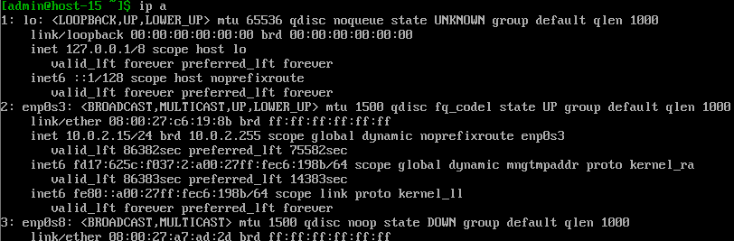
* 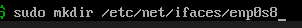
* 
* 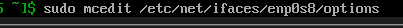
* 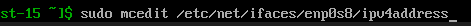
* 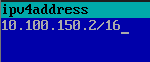
* 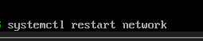

## 2
* проделала то же самое с новым интерфейсом enp0s9
* пинг проходит 
* 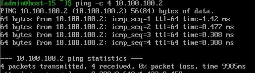

## 3
* созданы 2 пользователя
* вход работает 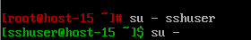
* 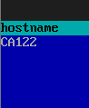

## 4
* установка ssh 
* 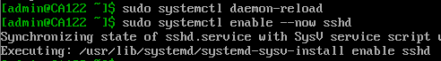
* конфиг файл ssh
* 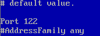 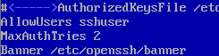
* файл баннера
* 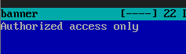
* 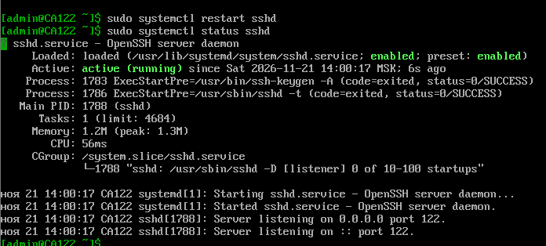
* 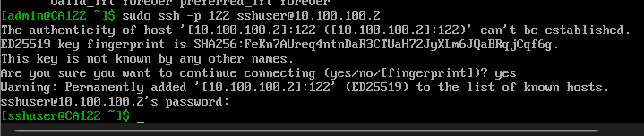

## 5
* это веб сервер
* 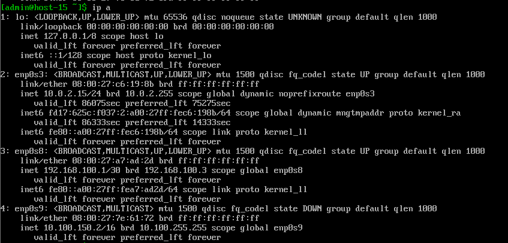
* это дата
* 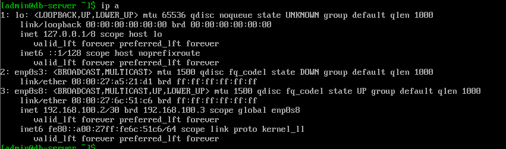
* 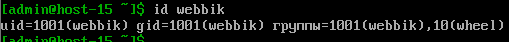
* 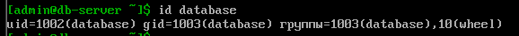
* пинг проходит
* 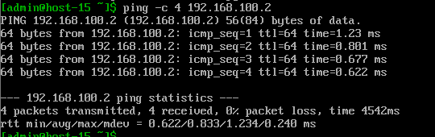
* то же и на дате
* 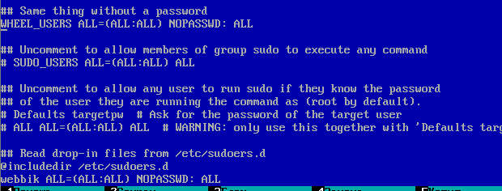

## 6
* проверка дисков
* 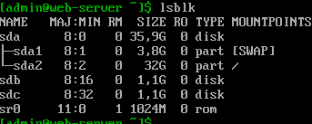
* создание и форматирование 
* 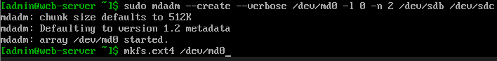
* 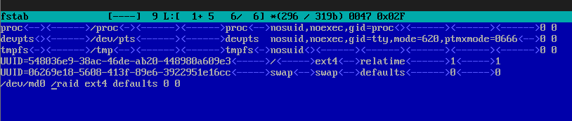
* 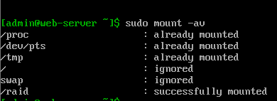
* 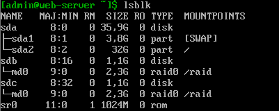

## 7
* -t nat таблица отвечает за изменение ip в пакетах, в отличие от стандартной F, которая разрешает/блок пакеты. цепочка postrouting - на выходе из сервера. -s == source, источник, правило только для подсети нужной. -o == output, -j masquerade == jump. Заменяет локальный адрес отправителя на текущий ip интерфейса enp0s3 и запоминает соединение для возврата. Есть еще dnat (меняется ip получателя)
* 
* сохранить правило и вкл службу в автозагрузку
* 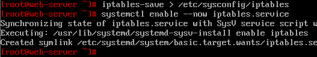
* потом в sysctl.conf разрешить маршрутизацию
* применить настройки
* 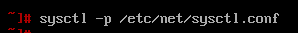
* указать шлюз и днс серверы в конфиг файлах
* 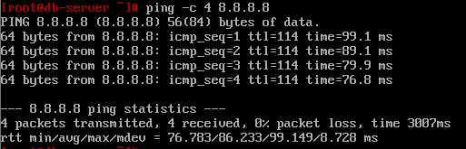
* 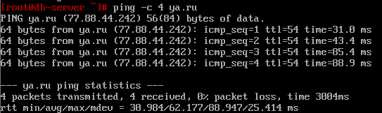
* флаг -n отключает поиск доменных имен и показыват ip 
* 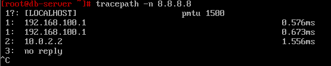 

## 8
* 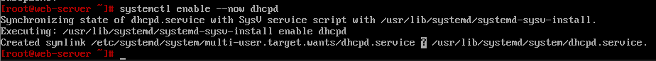
* 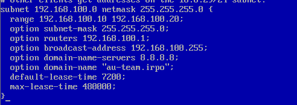
* 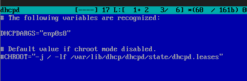
* 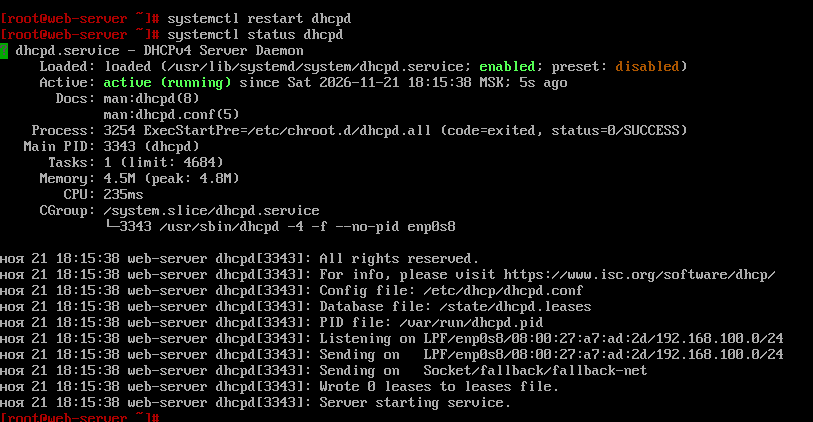
* настройка второй машины
* 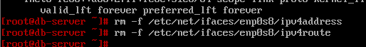
* 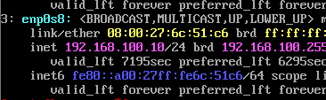

## 9
* 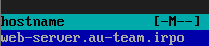
* 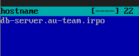
* ip
* 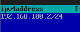
* 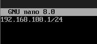
* resolv.conf
* 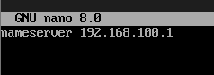
* вкл пересылку пакетов и установить шлюз
* 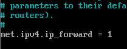
* 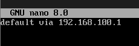
* 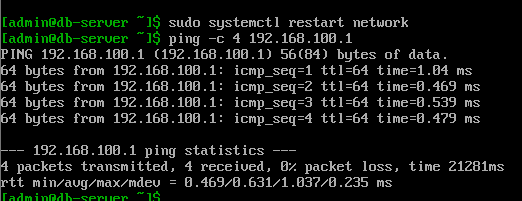
* 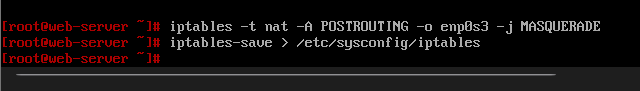
* пишу это в файл options.conf
* 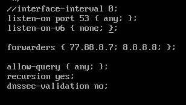
* в файле rfc1912.conf
* 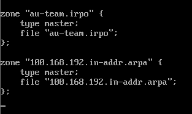
* создание файла прямой зоны
* 
* 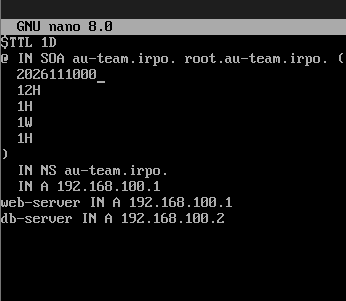
* создание файла обратной зоны
* 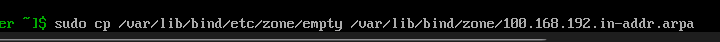
* 

* генерация ключа управления rndc
* 
* 
* 
* запускается так
* 
* 